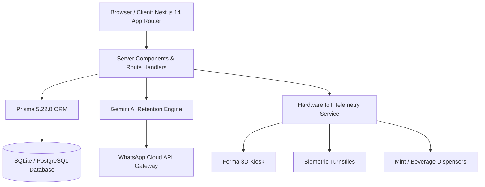

# APOLLO Enterprise Platform — Master Architecture & Operations Manual
**TriFit Pakistan Flagship Fitness Network**  
*Document Version: 4.2.0 • Last Updated: November 2026 • Environment: Production / Executive Cockpit*

---

## 1. Executive Summary & Mission

**APOLLO** is the custom-engineered enterprise operating system, AI-driven retention engine, and financial analytics platform designed specifically for **TriFit Pakistan** — the country's most advanced luxury fitness network.

Operating across 4 premier flagship clubs in Karachi and Islamabad with over 5,100 active members and generating **PKR 82.4M+ monthly consolidated revenue**, Apollo bridges the gap between physical club turnstiles, biometric scanning kiosks, front-desk staff, master coaches, and executive C-suite management.

### The Self-Funding Business Model
Unlike traditional gym software that acts merely as a digital ledger, Apollo operates as a **Self-Funding Profit & Retention Center**:
- **Monthly Enterprise Fee**: PKR 400,000 / month
- **Projected Monthly AI Revenue Lift**: +PKR 3,773,083 / month (9.4x Net ROI)
- **Time to 100% Payoff**: **3.2 Days** into every billing cycle
- **3 Priority Recovery Vectors**:
  1. **14+ Day Dormant Churn Mitigation**: Automated personalized WhatsApp interventions with personalized coach check-ins (35% recovery rate, +PKR 12.67M/yr protected value).
  2. **3-Month to 12-Month Upgrade Rollover**: Algorithmic targeting of month-2 active members before expiration to secure full annual upfront cash (+PKR 25.60M upfront cash added).
  3. **Forma 3D "Plateau-to-PT" Conversion**: Automated coaching package recommendation triggered when member scan telemetry detects a 30-day metabolic/body composition plateau (+PKR 7.01M PT revenue generated).

---

## 2. Network Topology & Multi-Branch Footprint

Apollo operates on a centralized database with real-time multi-tenant data synchronization across 4 strategic flagship facilities in Pakistan:

| Branch Name | City & Territory | Operational Role | Member Footprint | Monthly Revenue | Fuel Bar Share | Key Hardware & Studios |
|---|---|---|---|---|---|---|
| **Seaview DHA** | Karachi, Sindh | Flagship Oceanfront & R&D Lab | 1,840 Active (36%) | PKR 28.0M (34%) | PKR 1.48M | Forma 3D Kiosk, Reformer Studio, Cold Plunges, Biometric Turnstiles |
| **Clifton Executive** | Karachi, Sindh | High-Net-Worth Corporate Club | 1,420 Active (28%) | PKR 21.4M (26%) | PKR 1.13M | InBody 770, Hot Yoga Studio, Executive Coworking Lounge |
| **AJ Tower** | Islamabad, ICT | Federal Capital Flagship | 1,080 Active (21%) | PKR 18.1M (22%) | PKR 0.96M | High-Altitude Cardio Chamber, Olympic Lifting Platforms |
| **LuckyOne Mall** | Karachi, Sindh | High-Volume Retail & Family Mega-Club | 784 Active (15%) | PKR 14.9M (18%) | PKR 0.79M | Cycle Cinema, Functional Turf, Recovery Cryotherapy |
| **Network Consolidated** | **Pakistan-wide** | **All 4 Flagships** | **5,124 Active** | **PKR 82.4M / mo** | **PKR 4.36M / mo** | **Enterprise Network Grid** |

---

## 3. Official Membership Packages & Pricing Structure

TriFit operates two distinct plan tiers (Regular and Plus) structured across 3, 6, and 12-month prepaid terms. All pricing is strictly in **Pakistani Rupees (PKR)** with zero foreign currency symbols:

```
┌────────────────────────────────────────────────────────────────────────────────────────┐
│                                TRIFIT PAKISTAN MEMBERSHIP TIERS                        │
├────────────────────────────────────────────────────────────────────────────────────────┤
│  TIER            │ DURATION   │ UPFRONT PRICING  │ EFFECTIVE MONTHLY RATE │ VALUE BADGE│
├──────────────────┼────────────┼──────────────────┼────────────────────────┼────────────┤
│ TriFit Regular   │ 3 Months   │ PKR 52,999       │ PKR 17,666 / mo        │ Standard   │
│ TriFit Regular   │ 6 Months   │ PKR 84,999       │ PKR 14,167 / mo        │ Popular    │
│ TriFit Regular   │ 12 Months  │ PKR 122,999      │ PKR 10,250 / mo        │ Best Value │
├──────────────────┼────────────┼──────────────────┼────────────────────────┼────────────┤
│ TriFit Plus      │ 3 Months   │ PKR 65,999       │ PKR 22,000 / mo        │ Elite 3M   │
│ TriFit Plus      │ 6 Months   │ PKR 105,999      │ PKR 17,667 / mo        │ Executive  │
│ TriFit Plus      │ 12 Months  │ PKR 155,999      │ PKR 13,000 / mo        │ Best Value │
└────────────────────────────────────────────────────────────────────────────────────────┘
```

### Feature Entitlement Matrix:
- **TriFit Regular**:
  - Full Access to Home Flagship & Cross-Gym Multi-Gym Privileges
  - 4 Guest Passes per billing cycle
  - Complete Locker, Finnish Sauna, and Steam Room access
  - TriFit Mobile App workout logging & turnstile barcode pass
- **TriFit Plus**:
  - **All Regular Features Included**
  - **Personal Training**: 2 Comped Master Coach Consultations & 1-on-1 PT session allocations
  - **Unlimited Guest Passes** (accompanied entry)
  - Priority Booking for Reformer Pilates, Hot Yoga & Cycle Cinema
  - Complimentary Fuel Bar recovery beverage post-workout
  - 1 Free Forma 3D Full-Body Volumetric Scan per month

---

## 4. UI/UX Design System: Obsidian Gold Glassmorphic HUD

Apollo's interface is intentionally engineered as an **Obsidian Gold Heads-Up Display (HUD)** inspired by high-end avionics, Bloomberg Terminals, and luxury Swiss timepieces.

### Color Palette Tokens
- **Canvas Base (`--bg-primary`)**: `#070708` to `#0B0B0C` (Deep obsidian void, zero blue contamination).
- **Surface Elevation (`--bg-card`)**: `#121214` to `#161619` with `rgba(255, 255, 255, 0.03)` top specular highlight.
- **Glassmorphic Filter**: `backdrop-filter: blur(28px) saturate(180%)`.
- **Primary Brand Gold (`--accent-gold`)**: `#FFD60A` / `#FFD91C` (Rich, luminescent gold).
- **Amber Glow (`--accent-glow`)**: `rgba(255, 214, 10, 0.15)`.
- **Text Primary**: `#FCFAF1` (Warm pearl white, reducing eye fatigue compared to pure `#FFF`).
- **Text Secondary**: `#A1A5A9` / `#8E9296` (Neutral high-contrast slate).
- **Border Gradients**: `1px solid rgba(255, 255, 255, 0.08)` to `rgba(255, 214, 10, 0.25)` on active focus.
- **Success Cyan / Teal**: `#00F2FE` / `#10B981` (Used for positive revenue vectors and biometric scans).
- **Warning Coral**: `#EF4444` / `#F87171` (Used for churn risk and hardware maintenance flags).

### Strict UI Principles Enforced:
1. **Zero Popups / Modals**: Every detail, dossier, or configuration screen uses clean page-to-page routing or inline sliding drawers to preserve spatial orientation.
2. **Strict Currency Rule**: Every financial number displays the `PKR` prefix (e.g. `PKR 82.4M`, `PKR 122,999`). The `$` symbol is strictly forbidden.
3. **Data Density with Breathing Room**: Generous grid layouts (12-column systems) paired with crisp typography, micro-charts, and sparklines.

---

## 5. Technology Stack & Technical Architecture



- **Frontend & Server Framework**: Next.js 14 with React 18, React Server Components (RSC), and Server Actions.
- **Language**: TypeScript 5.6 (strict mode enabled with zero implicit `any`).
- **Styling**: Tailwind CSS 3.4 with custom CSS variables, custom glassmorphism utilities, and Lucide React icons.
- **Animations & Visualizations**: Framer Motion 11 for silky transitions and custom SVG data visualization curves (bezier splines, dual-line financial flows, and radial dials).
- **Database & Data Layer**: Prisma ORM with SQLite for local rapid dev (`prisma/dev.db`) and PostgreSQL ready for multi-region cloud deployment.
- **Testing & Quality Assurance**: Vitest 5.1 test suite verifying revenue reconciliation, pricing matrices, and branch isolation boundaries.
- **Hosting & CI/CD**: Vercel production hosting with automatic `.npmrc` legacy peer dependency resolution and continuous build verification.

---

## 6. Complete Master Route Directory

Apollo is structured across two primary authorization portals: **Admin Cockpit** (`/admin/*`) and **Branch Manager Portal** (`/branch/*`), plus public marketing and member-facing touchpoints:

### A. Executive Cockpit (`/admin/*`)
1. [`/admin`](file:///c:/Users/PMLS/Desktop/Apollo/src/app/admin/page.tsx) — **Consolidated Executive Cockpit**: Multi-branch KPI summary, CEO Self-Funding Simulator, 30-day AI lift, 4-club network grid, and recent revenue activations stream.
2. [`/admin/brain`](file:///c:/Users/PMLS/Desktop/Apollo/src/app/admin/brain/page.tsx) — **Apollo Brain & AI Engine**: Central control for Gemini retention algorithms, pending approval queues, campaign triggers, and member touchpoint logs.
3. [`/admin/growth`](file:///c:/Users/PMLS/Desktop/Apollo/src/app/admin/growth/page.tsx) — **Growth & Churn Leakage Telemetry**: Sankey-style member progression, cohorts, attrition root causes, and net growth velocity.
4. [`/admin/pipeline`](file:///c:/Users/PMLS/Desktop/Apollo/src/app/admin/pipeline/page.tsx) — **Sales & Lead Pipeline**: Full visual Kanban board tracking walk-ins, digital leads, consultations, trials, and closed memberships.
5. [`/admin/members`](file:///c:/Users/PMLS/Desktop/Apollo/src/app/admin/members/page.tsx) — **Unified Members CRM**: Global database of all 5,124 members across all 4 branches with advanced filters (Tier, Status, Days Inactive, Spend).
6. [`/admin/members/[id]`](file:///c:/Users/PMLS/Desktop/Apollo/src/app/admin/members/[id]/page.tsx) — **360° Member Dossier**: Comprehensive member profile including attendance heatmaps, Forma 3D volumetric history, and WhatsApp interaction log.
7. [`/admin/trainers`](file:///c:/Users/PMLS/Desktop/Apollo/src/app/admin/trainers/page.tsx) — **Master Coach & Trainer Accountability**: Coach utilization, client retention scores, revenue generated per trainer, and certification audits.
8. [`/admin/finance`](file:///c:/Users/PMLS/Desktop/Apollo/src/app/admin/finance/page.tsx) — **Finance, Ledgers & P&L**: Consolidated cash flow, expense analysis, Fuel Bar profitability, and direct Board P&L export.
9. [`/admin/flagships`](file:///c:/Users/PMLS/Desktop/Apollo/src/app/admin/flagships/page.tsx) — **4-Club Flagship Network Grid**: Detailed individual metrics for Seaview DHA, Clifton, LuckyOne, and AJ Tower.
10. [`/admin/studios`](file:///c:/Users/PMLS/Desktop/Apollo/src/app/admin/studios/page.tsx) — **Studio Yield & Pilates**: Reformer studio capacity utilization, peak-hour bottlenecks, and instructor-to-seat ratios.
11. [`/admin/kiosks`](file:///c:/Users/PMLS/Desktop/Apollo/src/app/admin/kiosks/page.tsx) — **Hardware & Kiosks Telemetry**: Live status of Forma 3D scanners, turnstiles, load-cell scales, and scent/mint dispensers across all clubs.
12. [`/admin/settings`](file:///c:/Users/PMLS/Desktop/Apollo/src/app/admin/settings/page.tsx) — **Platform Configuration & Security**: Role-based access control, WhatsApp API tokens, pricing rules, and audit logs.

### B. Branch Manager Operations (`/branch/*`)
1. [`/branch/today`](file:///c:/Users/PMLS/Desktop/Apollo/src/app/branch/today/page.tsx) — **Today's Club Ops**: Live turnstile entry ticker, hourly check-in curve vs capacity, and front-desk staff roster.
2. [`/branch/winback`](file:///c:/Users/PMLS/Desktop/Apollo/src/app/branch/winback/page.tsx) — **Branch AI Win-Back Queue**: Actionable list of absent members belonging strictly to this club with 1-click WhatsApp message approvals.
3. [`/branch/trainers`](file:///c:/Users/PMLS/Desktop/Apollo/src/app/branch/trainers/page.tsx) — **Floor Coach Management**: Shift scheduling, live floor presence, and member-trainer session logging.
4. [`/branch/classes`](file:///c:/Users/PMLS/Desktop/Apollo/src/app/branch/classes/page.tsx) — **Studio Schedules & Rosters**: Booking manifests, waitlists, and room capacity trackers for group classes.
5. [`/branch/equipment`](file:///c:/Users/PMLS/Desktop/Apollo/src/app/branch/equipment/page.tsx) — **Facility & Equipment Health**: Machine maintenance tracking, issue logging, and repair ticket dispatch.
6. [`/branch/prayer`](file:///c:/Users/PMLS/Desktop/Apollo/src/app/branch/prayer/page.tsx) — **Prayer & Ramadan Protocols**: Karachi/Islamabad prayer schedules, audio ducking triggers, and Ramadan nighttime hours.

---

## 7. Financial Analytics & Data Visualization Suite

Apollo includes a custom suite of high-fidelity SVG and HTML5 data visualization components engineered to render smoothly across all desktop, tablet, and mobile screens:

### Key Chart Components:
- **Dual-Spline Financial Flow Chart**: Displays daily/weekly/monthly revenue curves against operating expenses with interactive vertical hover crosshairs, custom tooltips, and dynamic range toggles (`5D`, `1M`, `3M`, `1Y`, `All`).
- **Radial Capacity Dials**: Displays real-time studio occupancy, turnstile velocity, and coach schedule capacity with glow effects.
- **Sankey Retention Funnel**: Traces member lifecycle from initial walk-in to 3-month trial, active retention, renewal risk, and successfully executed AI win-backs.
- **Branch Contribution Stacked Bar**: Illustrates the exact revenue breakdown per club between Membership Dues, Personal Training packages, and Fuel Bar sales.

---

## 8. Physical Hardware & Kiosk Integration

TriFit clubs are equipped with next-generation smart fitness hardware connected via local IoT relays to Apollo:

1. **Forma 3D Body Scanner & Kiosk**:
   - 360-degree volumetric infrared scan measuring body fat %, skeletal muscle mass, posture alignment, and visceral fat index.
   - Apollo ingests scan data in real-time. If a member's scan shows less than 0.5% progress over 30 days, Apollo flags them as a "Plateau Risk" and queues an automated PT consultation pitch to their assigned coach.
2. **Biometric RFID/NFC Turnstiles**:
   - Millisecond-latency check-ins linked directly to the member's subscription validity.
   - Automatically detects unauthorized entry attempts and immediately alerts the front-desk console.
3. **Smart Load-Cell Weight Scales**:
   - Connected locker-room scales that seamlessly sync weigh-ins to the member's private health file.
4. **Smart Hydration & Mint Dispensers**:
   - Controlled post-workout amenities that dispense electrolyte water and eucalyptus mints upon member RFID tap.

---

## 9. Seeded Personas & Access Credentials

To test and demonstrate the system, Apollo includes built-in test personas pre-seeded into the database:

| Persona | Name | Email | Password | Role & Scope |
|---|---|---|---|---|
| **Executive Admin** | Syed Rizwan | `admin@trifit.com` | `Password123!` | Global C-Suite (All 4 Flagships) |
| **Seaview Manager** | Farhan Akhtar | `manager.seaview@trifit.com` | `Password123!` | Karachi Seaview DHA Flagship |
| **Clifton Manager** | Zeeshan Malik | `manager.clifton@trifit.com` | `Password123!` | Karachi Clifton Executive Club |
| **Islamabad Manager** | Tariq Mehmood | `manager.ajtower@trifit.com` | `Password123!` | Islamabad AJ Tower Flagship |
| **Lead Master Coach** | Hamza Abbasi | `coach.hamza@trifit.com` | `Password123!` | Master Coach & PT Specialist |

*Note: The `/login` page provides quick-fill persona buttons for instant switching without typing.*

---

## 10. Local Setup & Production Deployment Guide

### Prerequisites
- Node.js version 18.17+ or 20.x
- npm version 9+ or 10+
- Git

### Installation Steps
```bash
# 1. Clone repository
git clone https://github.com/alishba-Wazir/Apollo.git
cd Apollo

# 2. Install dependencies (using legacy peer deps for strict vitest compatibility)
npm install --legacy-peer-deps

# 3. Setup and seed the SQLite database
npx prisma generate
npx prisma db push
npx tsx prisma/seed.ts

# 4. Start local development server
npm run dev
```
Open **`http://localhost:3000`** in your browser.

### Building for Production
```bash
# Build optimized production bundle
npm run build

# Start production server
npm start
```

### Automated Testing
```bash
# Run unit and integration tests
npm run test
```

---
*Apollo Enterprise Platform © 2026 TriFit Pakistan. All rights reserved. Confidential & Proprietary.*
